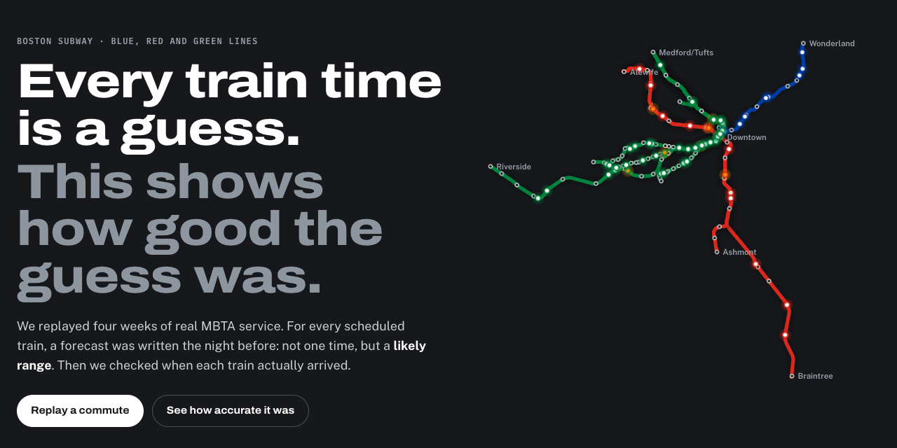
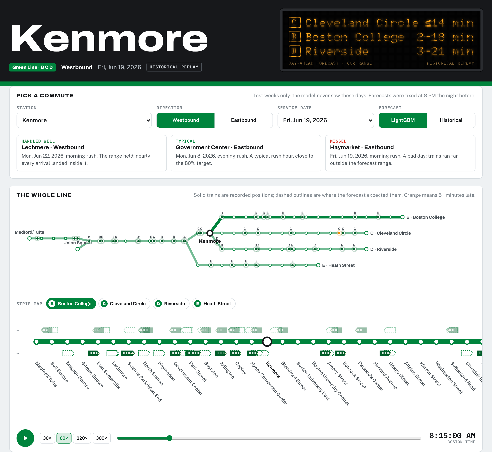
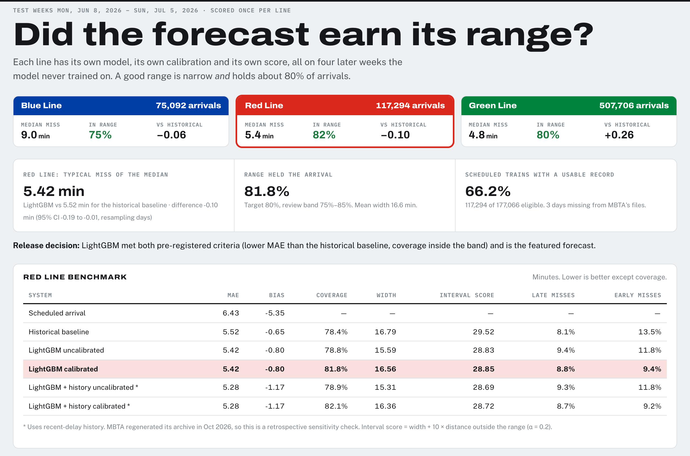
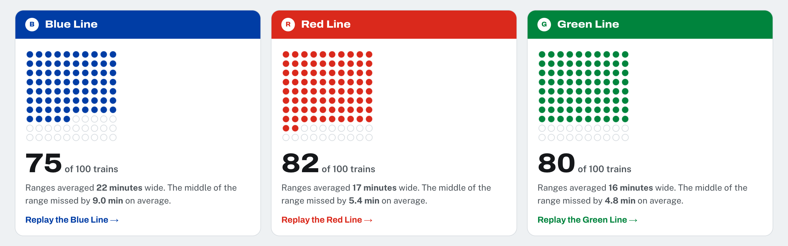
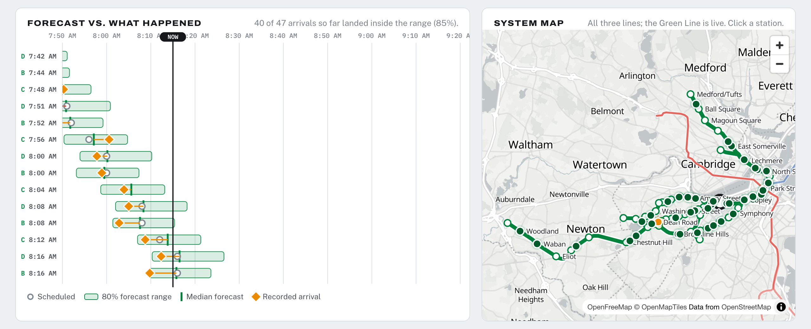
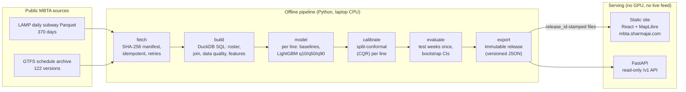
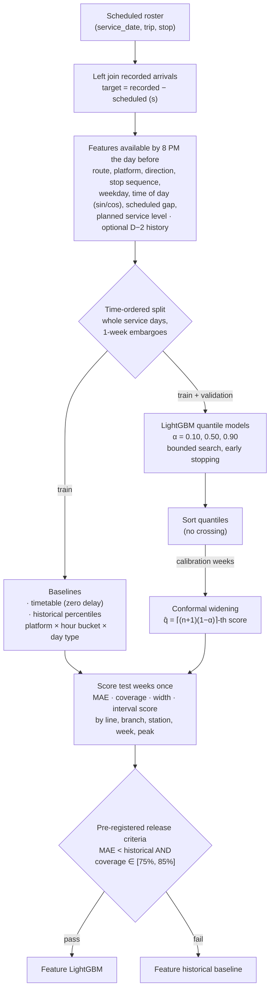
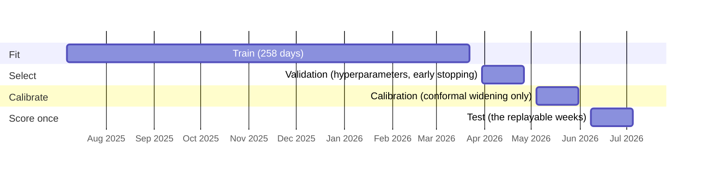

<div align="center">

<a href="https://mbta.sharmajai.com"></a>

# Boston Subway Replay

**How much should you trust a train arrival time?**<br/>
Day-ahead forecasts with calibrated uncertainty for every scheduled train on Boston's Blue, Red and
Green Lines, checked against what really happened.

<a href="https://mbta.sharmajai.com"></a>
<a href="https://github.com/jai0812/boston-transit-reliability/actions/workflows/pages.yml"></a>
<a href="https://github.com/jai0812/boston-transit-reliability/actions/workflows/ci.yml"></a>


<a href="LICENSE"></a>

<sub>Python · DuckDB · LightGBM · conformal prediction · FastAPI · React · TypeScript · MapLibre</sub>

</div>

> Unofficial project. Not affiliated with or endorsed by the MBTA. Built on MBTA's public data.

<table>
  <tr>
    <td width="58%" valign="top">
      <a href="https://mbta.sharmajai.com/#/replay?line=Green"></a>
      <br/><sub><b>Replay.</b> Kenmore on the Green Line. The countdown shows ranges, not minutes; the schematic shows every train on all four branches.</sub>
    </td>
    <td width="42%" valign="top">
      <a href="https://mbta.sharmajai.com/#/results?line=Red"></a>
      <br/><sub><b>Results.</b> Every system scored once per line on held-out weeks.</sub>
      <br/><br/>
      <a href="https://mbta.sharmajai.com/"></a>
      <br/><sub><b>For everyone.</b> "N of every 100 trains arrived inside their range."</sub>
    </td>
  </tr>
</table>

<a href="https://mbta.sharmajai.com/#/replay?line=Green"></a>
<sub><b>Forecast vs. what happened.</b> Each row is a scheduled train: grey circle = timetable, band = 80% range, bar = median, orange diamond = recorded arrival (revealed as the replay clock reaches it).</sub>

---

## In plain English

Transit apps show one arrival time, like "6 minutes", and riders learn not to believe it. This project
asks a better question: *how sure can we be?* The night before each day, a machine-learning model
predicted a likely **range** for every scheduled subway train in Boston, for example "between 8:14 and
8:21". We then compared those ranges with when **12.5 million** scheduled train arrivals actually
happened over a year of real MBTA data.

The website turns this into something anyone can explore. Pick a station, press play, and watch a real
morning commute replay on a live map, with each forecast checked as trains arrive.

### What was achieved

- **Built end to end.** Data pipeline, machine-learning models, evaluation, a public API and an
  interactive website, all reproducible from one command.
- **Honest ranges.** The calibrated forecasts caught **75–82%** of trains inside their predicted range
  against an 80% target, on four weeks of data the model never saw.
- **Red Line: a measurable win.** The model beat the historical baseline, and the difference is
  statistically clear (typical miss 5.42 vs 5.52 minutes, 95% interval of the gain below zero).
- **Green Line: a reported loss.** The model did *not* beat simple methods on accuracy, so the site
  features the simpler method. Results were published as measured, not as hoped.
- **Scale.** 370 days of train records, 122 timetable versions, 3 lines, 7 branches, 104 stations.
  The full model run takes about 12 minutes on a laptop CPU.

---

## Results at a glance

Scored **once** per line on the test weeks (June 8 – July 5, 2026). Every system was scored on the same
recorded arrivals. Lower is better except coverage, where the target is 80%.

| Line | Arrivals scored | Best accuracy (median miss) | LightGBM median miss | Range held arrival | Mean range width | Release decision |
| --- | ---: | --- | ---: | ---: | ---: | --- |
| **Red** | 117,294 | **LightGBM** | **5.42 min** (baseline 5.52) | **81.8%** | 16.6 min | LightGBM featured. Gain is significant: −0.10 min, 95% CI [−0.19, −0.01] |
| **Blue** | 75,092 | LightGBM (tie) | 8.97 min (baseline 9.03) | 75.2% | 21.6 min | LightGBM featured. Gain within noise: 95% CI [−0.12, +0.01] |
| **Green** | 507,706 | **Timetable** (4.49 min) | 4.82 min (baseline 4.56) | 79.9% | 16.1 min | **Historical baseline featured.** LightGBM failed the accuracy criterion |

**Plain reading.** On the Red Line the model is reliably a little better than "what usually happens at
this platform at this hour". On the Blue Line it is effectively tied. On the Green Line, where most
stops are on the street, neither forecasting method beat the printed timetable on the typical miss.
LightGBM still produced the best-calibrated ranges there (interval score 25.4 vs 25.7).

<details>
<summary><b>What each metric means</b></summary>

| Metric | Definition | Why it matters |
| --- | --- | --- |
| **MAE** (median miss) | Mean of \|recorded − predicted median\|, in minutes | How far the single best guess is off |
| **Coverage** | Share of recorded arrivals inside the 80% range (bounds inclusive) | Is the range honest? Target ≈ 80% |
| **Width** | Mean of upper − lower bound, in minutes | Is the range useful? Narrower is better, if coverage holds |
| **Interval score** | width + (2/α) × distance outside the range, α = 0.2 | One number that punishes both wide ranges and misses |
| **Pinball loss** | Quantile loss at 0.10 / 0.50 / 0.90 | Checks each quantile separately, tails included |
| **Observation coverage** | Usable recorded arrivals ÷ eligible scheduled arrivals | How much of the timetable could be checked at all |
| **Bootstrap CI** | 1,000 resamples of whole service days, MAE(model) − MAE(baseline) | Whether a difference is real or noise |

</details>

---

## The website

| Page | What it shows |
| --- | --- |
| **Home** | A plain-language explainer. A live map of all three lines replays a real weekday morning; a worked example walks through schedule → forecast range → actual arrival; each line gets a "caught N of every 100 trains" card. |
| **Replay** | Pick a line, station, direction and day. A station sign with an amber LED countdown shows each train as a range ("4–28 min"). A network schematic shows branches forking and merging. The strip map shows recorded trains (solid) and forecast "ghost" trains (dashed). The timeline reveals each recorded arrival as the clock reaches it. The system map has trails and arrival pulses. Includes a keyboard-accessible arrival table. |
| **Results** | Per-line benchmark, coverage by station, week and branch, and day-by-day data quality. |
| **Method** | Data, splits, model, calibration, and every known caveat. |

Interaction details: the whole UI recolors to the active line's color through an animated CSS
`@property`. Space plays and pauses, ← → move the clock a minute, and reduced-motion preferences turn
the animations off. On phones, diagrams scroll sideways inside their panels.

---

## System architecture



| Layer | Technology | Responsibility |
| --- | --- | --- |
| Acquisition | Python, httpx, PyArrow | Download index-listed files only, temp-file then rename, SHA-256 per file, skip unchanged partitions, retry on network errors |
| Transformation | DuckDB SQL | Resolve which timetable applies to each date, build the scheduled roster, left-join recorded arrivals, flag every failure mode |
| Modeling | LightGBM, NumPy, pandas | Per-line quantile models, bounded hyperparameter search, early stopping |
| Calibration and evaluation | NumPy | Conformal widening, segment metrics, day-level bootstrap, pre-registered release criteria |
| Serving | Static JSON + FastAPI + Pydantic | Same contract either way: `/v1/release`, `/v1/lines`, `/v1/stations`, `/v1/replay`, `/v1/metrics`, `/healthz` |
| Browser | React 19, TypeScript, Vite, MapLibre GL, d3-scale | Replay engine, schematic layout, strip and system maps, results charts |

**Design choices**

- **Static first.** The public site is a static build with a versioned release bundle (~46 MB of JSON,
  served gzip-compressed). There is no server to keep alive, and rolling back the site rolls back its data.
- **Immutable releases.** `release_id` is derived from the hash of every input file and the line
  configuration. A revised MBTA file produces a new release; it never silently changes an old one.
- **Fail loudly.** The build aborts on missing columns, duplicate keys or a many-to-many join, and
  asserts that no feature uses data from on or after the day before the forecast date.
- **Separation of concerns.** Model fitting never runs on a request path. A broken experiment cannot
  replace a working published release.

---

## Data

| Source | What we use | Volume |
| --- | --- | --- |
| [MBTA LAMP](https://github.com/mbta/lamp) subway performance files | `stop_timestamp` (recorded arrival), trip, stop, direction, LAMP's scheduled time for cross-checks | 370 daily files, Jun 2025 – Jul 2026 |
| [MBTA GTFS archive](https://cdn.mbta.com/archive/archived_feeds.txt) | trips, stop_times, calendar, calendar_dates, stops, shapes | 122 archived schedule versions (~4.6 GB of zips, filtered on extraction) |

**What every scheduled arrival can turn out to be.** The left join keeps every scheduled event, and none
are silently dropped.

| Status | Count | Meaning |
| --- | ---: | --- |
| `observed` | 8,880,446 | Matched to a recorded arrival. These are used for training and scoring |
| `unobserved` | 2,876,642 | Scheduled, but no matching record. Often the trip ran under a different ID |
| `source_gap` | 635,591 | The day's MBTA file is empty (19 days), so it's excluded from denominators |
| `conflict_direction` | 80,580 | Record disagrees with the schedule's direction. Quarantined |
| `suspicious` | 24,508 | More than 4 h late or 30 min early. Excluded from scoring and kept for inspection |
| `missing_timestamp` | 13,650 | Record exists, but its arrival time is empty |

Time handling: GTFS times are measured from "noon minus 12 hours" local time, so `25:10:00` correctly
lands at 01:10 the next calendar day, and both daylight-saving transitions are covered by tests.

---

## ML workflow



### Problem framing

- **Unit:** one scheduled arrival of one trip at one platform, keyed by (service date, trip, stop, stop sequence).
- **Forecast origin:** 8:00 PM Boston time on the day before. This is a *day-ahead* forecast, so nothing
  observed on the day itself is used.
- **Target:** delay in seconds = recorded arrival − scheduled arrival. Negative means early.
- **Output:** the 10th, 50th and 90th percentiles of delay. The median is the point forecast; the outer
  two give an initial 80% range.

### Time splits



One-week gaps between blocks act as embargoes, and complete service days are never split. History features stop at D−2.

### Baselines

| Baseline | How it works |
| --- | --- |
| **Timetable** | Predicts zero delay. The bar any model must clear. |
| **Historical percentiles** | 10th/50th/90th percentile delay from training data, grouped by platform × time-of-day bucket × weekday/weekend. A group needs ≥ 50 rows, otherwise it falls back to the platform, then line-wide. Frozen after training. |

### LightGBM configuration

Three independent quantile models per line and per feature set. Config:
[`configs/lightgbm.yaml`](configs/lightgbm.yaml).

| Setting | Value | Notes |
| --- | --- | --- |
| Objective | `quantile`, α ∈ {0.10, 0.50, 0.90} | Each scored with its own pinball loss |
| Search | 5 candidates: leaves {15, 31}, depth {4, 6}, min child {50, 100, 200}, LR {0.05, 0.10} | Selected by mean validation pinball loss |
| Rounds | ≤ 800, early stopping at 50 | Iterations recorded per quantile |
| Regularization | `reg_lambda` 1.0, `colsample_bytree` 0.85 | |
| Categoricals | route, platform | Vocabulary fit on training data; unseen values route to "missing" |
| Runtime | CPU, seed 42, 8 threads, deterministic | Blue 32 s · Red 42 s · Green 641 s |
| Selected | Blue, Red: 15 leaves / depth 4 · Green: 31 leaves / depth 6, LR 0.10 | Quantile crossing on validation: 0% |

Two feature sets are trained. **Schedule-only** is the primary model. **Schedule + history** adds rolling
7- and 28-day medians of daily per-platform medians and daily 90th percentiles, up to D−2. It is a
*retrospective sensitivity* model, because MBTA regenerated its archive in October 2026 and the as-of
contents can't be verified.

### Calibration: conformalized quantile regression

On the calibration weeks, each score is `max(lower − y, y − upper)`. With n scores and α = 0.2, take the
⌈(n+1)(1−α)⌉-th smallest as q̂, and widen both ends of every range by max(0, q̂). This is the method of
Romano, Patterson & Candès (2019). The guarantee assumes exchangeable data, which consecutive trains are
not, so coverage is reported *empirically* on the later test weeks.

| Line | Calibration rows | Coverage before | Widening per side |
| --- | ---: | ---: | ---: |
| Blue | 86,314 | 77.4% | 20 s |
| Red | 111,144 | 75.1% | 29 s |
| Green | 456,054 | 73.4% | 70 s |

### Full benchmark (test weeks)

<details>
<summary><b>Blue Line</b>: 75,092 arrivals, 71.7% of eligible scheduled arrivals</summary>

| System | MAE | Bias | Coverage | Width | Interval score | Late misses |
| --- | ---: | ---: | ---: | ---: | ---: | ---: |
| Timetable | 9.36 | −7.75 | — | — | — | — |
| Historical baseline | 9.03 | −5.99 | 72.1% | 21.39 | 58.21 | 12.3% |
| LightGBM uncalibrated | 8.97 | −5.81 | 72.6% | 20.89 | 58.21 | 11.4% |
| **LightGBM calibrated** | **8.97** | −5.81 | **75.2%** | 21.57 | 58.01 | 11.2% |
| LightGBM + history, calibrated* | 9.06 | −5.86 | 74.3% | 20.07 | **57.52** | 12.9% |

Weekly coverage: 86.0% · 76.3% · 88.3% · **41.7%**. The last week (from June 29) ran far behind schedule
and broke calibration. That makes it the strongest case for adaptive recalibration.
</details>

<details>
<summary><b>Red Line</b>: 117,294 arrivals, 66.2% of eligible scheduled arrivals</summary>

| System | MAE | Bias | Coverage | Width | Interval score | Late misses |
| --- | ---: | ---: | ---: | ---: | ---: | ---: |
| Timetable | 6.43 | −5.35 | — | — | — | — |
| Historical baseline | 5.52 | −0.65 | 78.4% | 16.79 | 29.52 | 8.1% |
| LightGBM uncalibrated | 5.42 | −0.80 | 78.8% | 15.59 | 28.84 | 9.4% |
| **LightGBM calibrated** | **5.42** | −0.80 | **81.8%** | 16.56 | 28.85 | 8.8% |
| LightGBM + history, calibrated* | 5.28 | −1.17 | 82.1% | 16.36 | **28.72** | 8.7% |

Weekly coverage: 79.5% · 83.6% · 87.4% · 75.0%. The history model's gain is the largest on any line
(−0.24 min, 95% CI [−0.36, −0.11]), but it is retrospective (see above).
</details>

<details>
<summary><b>Green Line</b>: 507,706 arrivals, 86.0% of eligible scheduled arrivals</summary>

| System | MAE | Bias | Coverage | Width | Interval score | Late misses |
| --- | ---: | ---: | ---: | ---: | ---: | ---: |
| **Timetable** | **4.49** | −1.29 | — | — | — | — |
| Historical baseline (featured) | 4.56 | +0.26 | 75.3% | 14.44 | 25.66 | 8.2% |
| LightGBM uncalibrated | 4.82 | −0.15 | 73.1% | 13.72 | 25.75 | 9.8% |
| LightGBM calibrated | 4.82 | −0.15 | **79.9%** | 16.05 | 25.35 | 7.5% |
| LightGBM + history, calibrated* | 4.66 | −0.19 | 80.1% | 15.28 | **24.55** | 7.3% |

By branch (calibrated LightGBM): B 4.30 min / 83.3% · C 4.21 / 86.3% · D 4.89 / 82.1% · E 5.70 / 69.9%.
Weekly coverage held steady at 79–81%.
</details>

\* Retrospective sensitivity analysis. Bootstrap CIs resample whole service days, so they understate
uncertainty if days are correlated.

---

## Findings and limitations

- **Heavy-tailed delay.** Subway lines run to headways. When a train starts late, or another train takes
  over a scheduled trip, "delay against that trip" can reach tens of minutes even though riders still see
  frequent trains. On the Blue Line, 10% of matched test arrivals were 24+ minutes behind their trip's
  schedule, and that spread is already there at the first stop. This is why ranges are wide. A
  passenger *wait-time* target is the natural next experiment.
- **Unmatched trips.** 24% of scheduled arrivals (outside source gaps) have no exact record match. MBTA
  logs many trains under `ADDED-` trip IDs (25–32% of Red Line rows on a sample day). Matching stays exact by design, and the misses are reported.
- **Retrospective schedules.** 98.9% of archived schedule versions carry a publication stamp after their
  day-ahead forecast origin. The benchmark is therefore labeled retrospective.
- **Distribution shift.** Calibration from May held through June on Red and Green, but not in Blue's
  final week. Fixed split-conformal calibration is a known weakness under shift.

---

## Repository

```
app/api/            FastAPI read-only service (same contract as the static JSON)
app/web/            React + TypeScript + Vite + MapLibre site
  src/pages/        Home, Replay, Results, Method
  src/components/   Board (LED sign), Schematic, LineStrip, Timeline, MapView, EventTable
  src/trains.ts     replay engine: train positions, branch conversion, schematic layout
  public/api/v1/    the bundled release (per line: stations, metrics, replay/<date>.json)
pipeline/sql/       planned_events.sql, joined_events.sql (DuckDB)
pipeline/transit/   fetch.py, build.py, model.py (train/calibrate/evaluate), export.py
configs/            data.yaml (lines, splits), lightgbm.yaml (search, release criteria)
tests/              DST, 25:00 times, joins, ms timestamps, source gaps, metrics, API contract
docs/               DEPLOY.md, EXTENSIONS.md
```

## Run it

```bash
make bootstrap                                     # uv sync + npm ci
make fetch                                         # ~2.4 GB raw cache, idempotent and checksummed
make build-data train calibrate evaluate export    # ~15 min on a laptop CPU
make dev                                           # http://localhost:5173
make serve                                         # FastAPI + built site on http://localhost:8000
make verify                                        # pytest + ruff + tsc
```

Train one line: `uv run python -m pipeline.transit.model train --line Red`.

Example API call:
`GET /v1/replay?line=Green&station_id=place-kencl&direction_id=0&service_date=2026-06-19` returns UTC ISO
timestamps for the scheduled time, median, interval bounds and recorded arrival, plus a distinct status
for a missing forecast vs. a missing recorded arrival.

**Reproducibility.** Every model writes a training manifest (code commit, package versions, seed,
threads, hardware, duration), and every release records input checksums. CI
([`.github/workflows/ci.yml`](.github/workflows/ci.yml)) runs lint, tests, type-check and the site build
on each push.

Deployment to `mbta.sharmajai.com`: [docs/DEPLOY.md](docs/DEPLOY.md).

## Roadmap

Ranked in [docs/EXTENSIONS.md](docs/EXTENSIONS.md):

1. Adaptive conformal calibration (MAPIE) for weeks like Blue's last.
2. A "cost of unreliability" panel that uses FRED wage data.
3. A live mode built on the MBTA V3 API.
4. A foundation-model benchmark (Chronos, TimesFM).
5. A GPU trip layer (deck.gl) for buses and the Orange Line.

## References

- MBTA LAMP and GTFS archive: https://performancedata.mbta.com/ · https://github.com/mbta/lamp
- Romano, Patterson, Candès (2019). *Conformalized Quantile Regression.* NeurIPS.
- Gibbs, Candès (2021). *Adaptive Conformal Inference Under Distribution Shift.* NeurIPS.
- Ke et al. (2017). *LightGBM: A Highly Efficient Gradient Boosting Decision Tree.* NeurIPS.
- Probabilistic transit travel-time prediction, *Transportation Research Part C* (2026).
- Basemap © OpenStreetMap contributors via OpenFreeMap.

## License

Code is MIT-licensed ([LICENSE](LICENSE)). The data in `app/web/public/api` is derived from the MBTA's
public performance data and GTFS archive and remains subject to the
[MBTA developer license agreement](https://www.mass.gov/files/documents/2017/10/27/develop_license_agree_0.pdf) and [terms of use](https://www.mbta.com/policies/terms-use).
